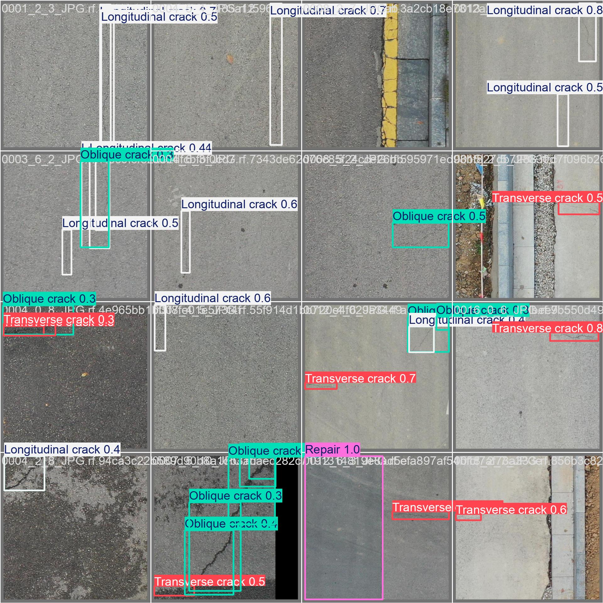
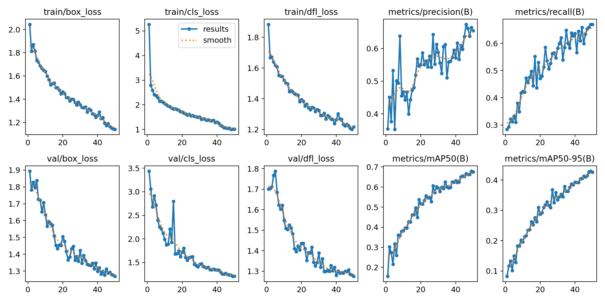

# Road Crack & Damage Detection with YOLOv8

Detects cracks, potholes and repairs in road-surface images using YOLOv8n.
Built to explore computer vision for civil infrastructure inspection, and exported to ONNX for edge deployment.

## Results
Evaluated on the validation split after 50 epochs.

| Metric | Value |
|---|---|
| mAP@0.5 | 0.680 |
| mAP@0.5:0.95 | 0.432 |
| Precision | 0.665 |
| Recall | 0.669 |
| Inference speed | 4.87 ms/image on T4 GPU (plus 1.92 ms preprocess, 2.52 ms postprocess) |




## Dataset
Road crack dataset from Roboflow Universe (`okul-ntg10/crack-obr1a`, version 1), licensed **CC BY 4.0**:
https://universe.roboflow.com/okul-ntg10/crack-obr1a/dataset/1

- 7 classes: Alligator crack, Block crack, Longitudinal crack, Oblique crack, Pothole, Repair, Transverse crack
- Images: 1,681 train / 240 validation / 480 test

## Setup
```bash
pip install -r requirements.txt
python train.py --data path/to/data.yaml --epochs 50
```
Download the dataset in YOLOv8 format and make sure the paths in `data.yaml` point to your local folders.

## Approach
- Model: YOLOv8n fine-tuned from COCO-pretrained weights
- Image size 640, 50 epochs, batch 16, trained on a Colab T4 GPU
- Metrics (precision, recall, mAP) and speed saved to `results.json`
- Best model exported to ONNX (12.2 MB) for edge deployment

## Limitations / Next steps
- [Add one or two real failures you saw in the predictions, e.g. a class that is often missed]
- Quantize to INT8 and benchmark on edge hardware
- Try a larger model (YOLOv8s) and more epochs to improve mAP

## Credits
Dataset: okul-ntg10, Roboflow Universe, CC BY 4.0. Model: Ultralytics YOLOv8.
